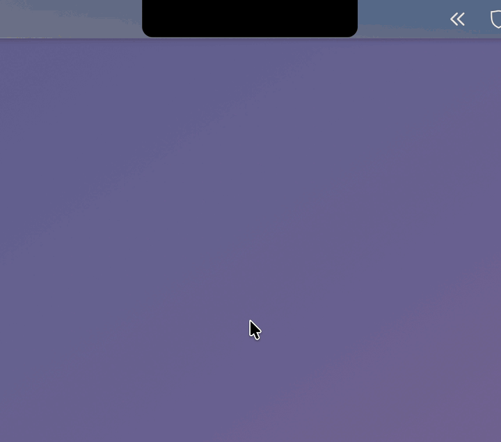

# Topstash

Save clipboard text from your MacBook's notch.

Hover over the notch, click once, and the text on your clipboard is saved as a Markdown note. Built for keeping the useful one-off prompts you find online in one place, where you can find them again and paste them into your coding agent.

<p align="center">
  
</p>

> **Early development (v0.1.0).** There are no signed or notarized releases yet, so build it from source to try it.

## Features

- Hover over the notch, click to save your clipboard.
- Click a recent note to copy it back.
- Search every note: ↑/↓ select a result, Return copies it and closes the panel.
- Notes are plain Markdown files in `~/Documents/Topstash/`, or a folder you choose.
- ⌥⌘S saves from anywhere. You can change the shortcut in Settings.
- Works on external displays: hover over the top center of the screen.
- Everything stays on your Mac. Topstash makes no network connections.

## Requirements

- macOS 14 (Sonoma) or later
- Xcode with Swift 6 (to build from source)

## Building from source

The Xcode project is generated from `project.yml` with [XcodeGen](https://github.com/yonaskolb/XcodeGen) and is not checked in.

```sh
brew install xcodegen
xcodegen generate
xcodebuild -scheme Topstash -configuration Debug build
```

To run the tests:

```sh
xcodebuild test -scheme Topstash -destination 'platform=macOS'
```

## Usage

Topstash has no Dock icon. Find it in the menu bar for Settings and Quit.

## Contributing

See [CONTRIBUTING.md](CONTRIBUTING.md).

## License

[MIT](LICENSE)
